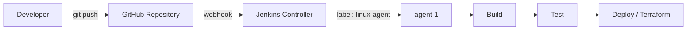

# Jenkins CI/CD Practice


A hands-on Jenkins project running on AWS EC2. It demonstrates Pipeline as Code, GitHub webhook automation, a distributed controller-agent setup, parameterized pipelines with manual approval, and Terraform automation.

## Table of Contents

- [Overview](#overview)
- [Architecture](#architecture)
- [Repository Structure](#repository-structure)
- [Pipelines](#pipelines)
- [Prerequisites](#prerequisites)
- [Getting Started](#getting-started)
- [Verifying the Controller-Agent Setup](#verifying-the-controller-agent-setup)
- [Troubleshooting](#troubleshooting)
- [Security Notes](#security-notes)
- [Key Learnings](#key-learnings)
- [Roadmap](#roadmap)

## Overview

| Component | Details |
|---|---|
| CI/CD server | Jenkins 2.580.2 on AWS EC2 (Amazon Linux 2023) |
| Controller | Jenkins service listening on port `8080` |
| Agent | `agent-1`, labeled `linux-agent`, connected over WebSocket |
| Trigger | GitHub webhook on every push |
| Pipeline style | Declarative Pipeline, loaded from source control |
| Infrastructure as Code | Terraform (local provider demo, no cloud cost) |

## Architecture



When a developer pushes code, GitHub sends a webhook to the Jenkins controller. The controller schedules the job and dispatches it to an agent whose label matches the pipeline. The agent then runs the build, test, and deploy stages in its own workspace.

## Repository Structure

```
jenkins-practice/
├── Jenkinsfile                                   # Root pipeline used by hello-job
├── hello.sh                                      # Demo script
├── .gitignore                                    # Excludes Terraform state and cache
├── Day-3-jenkins-master-slave/
│   └── Jenkinsfile-run-matching-labels           # Label-based agent selection
├── Day-4-parameters-and-approval/
│   └── Jenkinsfile-when-and-script               # Parameters, when, input, script
└── Day-5-terraform-jenkins/
    ├── Jenkinsfile-ex6-apply-destroy-parameter   # Terraform apply/destroy pipeline
    └── terraform-demo/
        └── main.tf                               # Safe demo configuration
```

## Pipelines

| Pipeline | Path | Demonstrates |
|---|---|---|
| Root pipeline | `Jenkinsfile` | Stages, `post` actions, agent label, checkout from SCM |
| Label routing | `Day-3-jenkins-master-slave/Jenkinsfile-run-matching-labels` | Targeting a specific agent with `agent { label '...' }` |
| Parameters and approval | `Day-4-parameters-and-approval/Jenkinsfile-when-and-script` | `parameters`, `when`, `input`, `script` |
| Terraform automation | `Day-5-terraform-jenkins/Jenkinsfile-ex6-apply-destroy-parameter` | `init`, `plan`, manual approval, then `apply` or `destroy` |

The Terraform demo uses the `local` provider and only creates a text file. It requires no AWS credentials and incurs no cost, while following the same workflow used for real cloud infrastructure.

## Prerequisites

- A running Jenkins controller with the Git and Pipeline plugins installed
- At least one online agent with the label `linux-agent`
- Terraform installed on the agent machine (required for Day-5 only)

Install Terraform on Amazon Linux:

```bash
sudo yum install -y yum-utils
sudo yum-config-manager --add-repo https://rpm.releases.hashicorp.com/AmazonLinux/hashicorp.repo
sudo yum -y install terraform
terraform --version
```

## Getting Started

### 1. Run a pipeline from this repository

1. In Jenkins, select **New Item** and choose **Pipeline**.
2. Under **Pipeline**, set **Definition** to `Pipeline script from SCM`.
3. Set **SCM** to `Git` and **Repository URL** to `https://github.com/jishan030/jenkins-practice.git`.
4. Set **Branch Specifier** to `*/main`.
5. Set **Script Path** to the pipeline you want to run, for example `Day-4-parameters-and-approval/Jenkinsfile-when-and-script`.
6. Save the job and select **Build Now**.

For parameterized pipelines, the first build runs without the parameter form. From the second build onward, use **Build with Parameters**.

### 2. Connect an agent

1. Go to **Manage Jenkins → Nodes → New Node** and create a Permanent Agent labeled `linux-agent`.
2. Select **Launch agent by connecting it to the controller**, then copy the secret from the node page.
3. Start the agent on the target machine:

```bash
mkdir -p ~/Jenkins-agent && cd ~/Jenkins-agent
curl -sO http://localhost:8080/jnlpJars/agent.jar
nohup java -jar agent.jar \
  -url http://localhost:8080/ \
  -secret <SECRET> \
  -name "agent-1" \
  -webSocket \
  -workDir "$HOME/Jenkins-agent" > agent.log 2>&1 &
```

### 3. Enable automatic builds

1. In the GitHub repository, go to **Settings → Webhooks → Add webhook**.
2. Set **Payload URL** to `http://<controller-address>:8080/github-webhook/` (the trailing slash is required).
3. Set **Content type** to `application/json` and select the push event.
4. In the Jenkins job, enable **GitHub hook trigger for GITScm polling**.

## Verifying the Controller-Agent Setup

Open the Console Output of a build and check the first lines:

| Output | Meaning |
|---|---|
| `Running on agent-1 in /home/ec2-user/Jenkins-agent/workspace/...` | The job ran on the agent |
| `Running on Jenkins in /var/lib/jenkins/workspace/...` | The job ran on the controller |

As a second check, stop the agent with `pkill -f agent.jar` and trigger a build. The build remains queued with the message "Waiting for next available executor" until the agent reconnects, which confirms that label-based routing works.

## Troubleshooting

| Symptom | Resolution |
|---|---|
| `Couldn't find any revision to build` | Verify the branch name in **Branch Specifier** (`*/main`) |
| `Jenkinsfile not found` | Check the **Script Path** and the exact file name |
| Build waits for an executor | No online agent matches the label; check the node status |
| Webhook shows a red cross | Open port `8080` in the Security Group and verify the Payload URL |
| Terraform `destroy` cannot find state | Run `apply` and `destroy` on the same node, because state is stored in the workspace |
| Parameter form is missing | Run the job once; the form appears from the second build |

## Security Notes

- No secrets, tokens, or IP addresses are stored in this repository.
- Store credentials in Jenkins Credentials and reference them with `withCredentials`.
- For AWS access, prefer an IAM role attached to the instance over static access keys.
- Restrict inbound access to port `8080` to trusted IP ranges when webhook testing is not in progress.
- Terraform state and plan files are excluded through `.gitignore`.

## Key Learnings

- The CI/CD flow: push, webhook, build, test, deploy
- Pipeline as Code using Declarative syntax
- Controller-agent architecture and label-based job routing
- Parameters, conditional stages, and manual approval gates
- Running Terraform workflows from Jenkins

## Roadmap

- [ ] Docker-based dynamic agents
- [ ] Credentials management with `withCredentials`
- [ ] Parallel stages
- [ ] Email and Slack notifications
- [ ] Multibranch pipeline
- [ ] Remote Terraform state (S3 backend)

## Author

**Jishan Khan**: [github.com/jishan030](https://github.com/jishan030)
